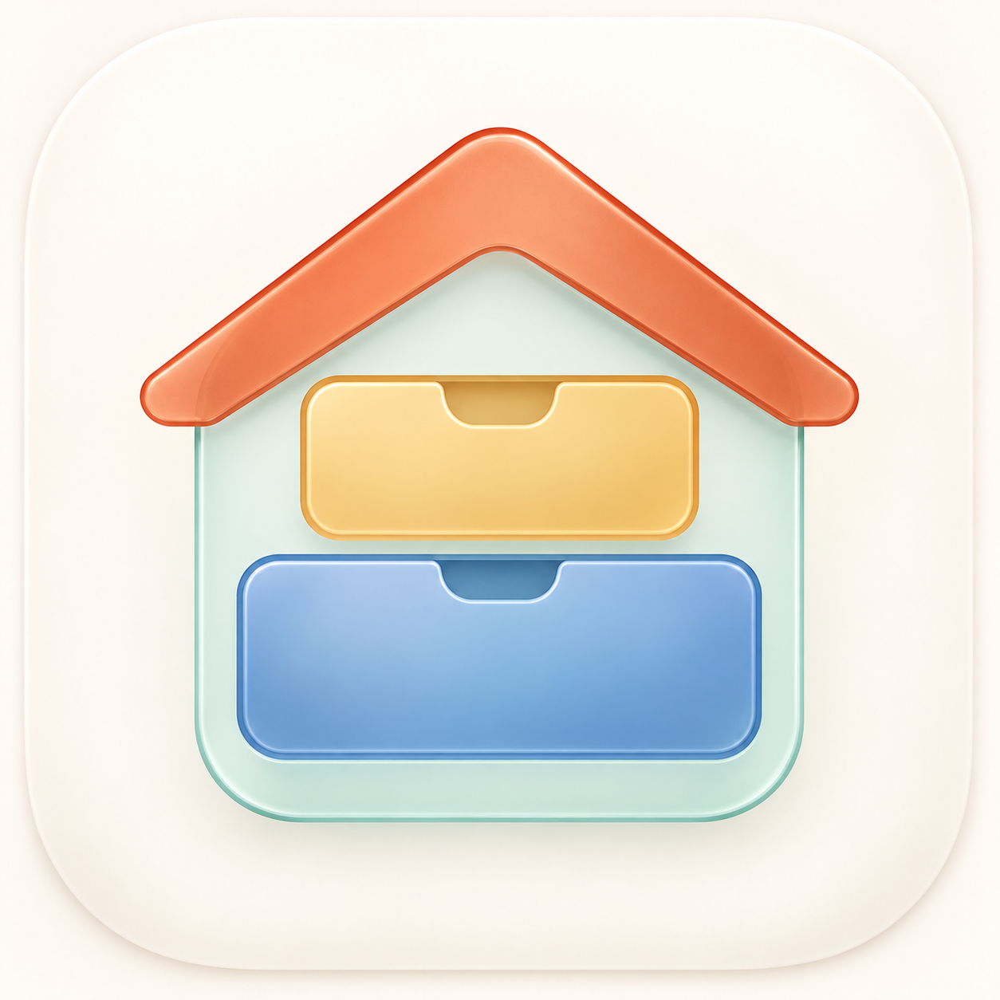

# Design Code Reference v1

Status: versioned visual reference proposal. The app-icon composition is accepted as a concept; this bundle does not replace the production app icon or claim that the interface has been implemented.

The [current shipped design guide](../../README.md), source, tests, and repository instructions continue to own implemented behavior. Within this reference bundle, the PDF tables and JSON specify exact values; the PNG boards illustrate visual composition and material.

## Reference Files

| File | Purpose |
| --- | --- |
| [Accepted app-icon composition](accepted-app-icon.png) | The selected house-and-cabinet concept |
| [Visual design handbook](home-stuff-design-code-v1.pdf) | Twelve pages covering palette, type, geometry, icons, components, states, and screen composition |
| [Design tokens](design-tokens.json) | Proposed adaptive values and documented semantic mappings |
| [Foundations and icons](boards/01-foundations-icons.png) | Palette and content-glyph family |
| [Components](boards/02-components.png) | Cards, rows, controls, form groups, and empty state |
| [Light screens](boards/03-light-screens.png) | Locations, Inventory, and Item Detail concepts |
| [Dark screens](boards/04-dark-screens.png) | Location Detail, Storage Place Detail, and Add Item concepts |

## Visual Language

- Use consistent axes, spacing, and continuous corner geometry to express order.
- Keep Location teal, Storage Place plum, Item blue, primary action indigo, and context amber. Terracotta belongs to brand artwork.
- Keep primary text and values neutral. Use native semantic primary and secondary text colors.
- Use original content glyphs for household entities; retain native symbols for system actions.
- Small glyphs stay flat and legible. Large identity illustrations may use two purposeful planes and restrained colored-glass treatment.
- Keep dense content, notes, and form fields on stable surfaces. Native controls and navigation own the functional glass layer.
- Preserve the native Locations / Inventory / Settings tabs, separate Search role, current activation, and existing navigation behavior.

The accepted icon's centered drawer notch and coherent rounding inform storage glyphs. Cabinet, drawer, box, shelf, and organizer must remain distinguishable by silhouette.

## Proposed Palette

| Role | Light | Dark |
| --- | --- | --- |
| Location | `#147872` | `#5CC5BC` |
| Storage Place | `#745B84` | `#C9B2D5` |
| Item | `#386CB3` | `#78A9EF` |
| Primary action | `#6654C2` | `#A89BFF` |
| Context | `#936400` | `#F2C34D` |
| Background | `#F5F2ED` | `#17181C` |
| Content surface | `#FFFDFA` | `#24262D` |

The JSON also includes increased-contrast variants, brand-text colors, illustration-only fills, and preview text colors. Preview text HEX values do not replace platform semantic text colors.

Opaque sRGB calculations give the proposed light accents at least 4.61:1 against the proposed grouped background and at least 5.07:1 against the content surface. These calculations do not validate translucent materials or a working accessibility implementation.

## Geometry and Icon Contract

- Retain native Dynamic Type and semantic text styles.
- Use a 4 pt spacing rhythm, 20 pt screen margins, 16 pt card padding, and 12 pt compact padding.
- Use 14 / 20 / 24 pt continuous radii for compact, card, and identity surfaces.
- Preserve minimum 44 by 44 pt interactive targets and content-driven heights.
- Construct small glyphs on a 24 pt grid, with approximately 1.75-2 pt strokes and at least 2 pt clear gaps.
- Redraw larger glyphs optically; do not enlarge small glyphs mechanically or add glass effects to compensate for weak silhouettes.

The raster boards are concept references. Production icon layers and vector glyphs require separate optical finishing and platform validation. Do not copy painted navigation bars or controls from a board into custom UI.

## Existing Owners

Use the current shared owners instead of introducing a parallel theme or component framework:

- [InventoryDesign.swift](../../../../HomeStuffInventoryApp/InventoryPresentation/InventoryDesign.swift)
- [InventoryIconPrimitives.swift](../../../../HomeStuffInventoryApp/Views/Shared/InventoryIconPrimitives.swift)
- [InventoryGlassSurfaces.swift](../../../../HomeStuffInventoryApp/Views/Shared/InventoryGlassSurfaces.swift)
- [Adaptive assets](../../../../HomeStuffInventoryApp/Resources/Assets.xcassets)

The reference was reviewed against public main [`9b9f9a0`](https://github.com/stradivarius-ios-apps/home-stuff-inventory-app/commit/9b9f9a06de81cf7b082e4228a146bfc021be57fc). It describes presentation only and does not change data compatibility, capability availability, privacy behavior, or release configuration.

## Reference Lifecycle

Keep v1 as a stable reference. A revised design bundle should have a separate version or an explicit documented correction. Update the current shipped guide only when an implemented change is verified; publishing this reference is not evidence of shipped behavior.

Relevant platform guidance: [Materials](https://developer.apple.com/design/human-interface-guidelines/materials), [Layout](https://developer.apple.com/design/human-interface-guidelines/layout), and [App icons](https://developer.apple.com/design/human-interface-guidelines/app-icons).
